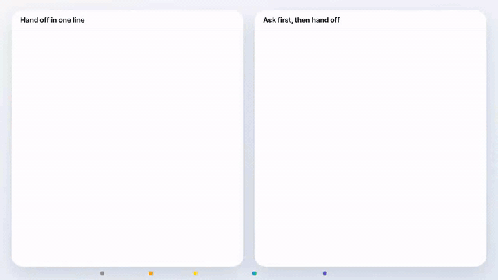

# Epistemic Protocols

> [한국어](./README_ko.md)

When AI collaboration goes off-track, you redo everything. These protocols bring the decisions that set the direction to you early — often at the plan level, before a wrong one hardens into code or other downstream work — and leave each one yours to settle.

<a name="why"></a>
A prompt that already states everything that matters can work nearly as well, but writing it means recalling every unknown up front. With a protocol, the AI asks questions or shows candidates at the right point, and you answer or recognize what fits.

Watch three agents handle the same request with and without `/elicit` (click for the video):

<a href="media/elicit.en.mp4"></a>

<sub>Companies, reasons and numbers in the clip are illustrative, not a run result.</sub>

Watch `/inquire` check the sources for next week's churn meeting and return what it confirmed, what conflicts, what it could not reach, and what only you decide (click for the video):

<a href="media/inquire.en.mp4"></a>

<sub>Meetings, sources and numbers in the clip are illustrative, not a run result.</sub>

## Quick Start

### Claude Code

Install every protocol, together with the [`route`](#route) plugin:

```bash
curl -fsSL https://raw.githubusercontent.com/jongwony/epistemic-protocols/main/scripts/install.sh | bash
```

`route` gives the agent the information it needs to choose a protocol for your conversation and find relevant collaboration principles when needed. It is experimental; its wording and hooks can change between releases. To disable it, run `claude plugin disable route@epistemic-protocols` after installing — every protocol stays installed. You can always type a command yourself, such as `/inquire` before handing off work or `/bound` when you are unsure which decisions are yours.

Not sure which protocol to start with? Clone this repository and start `/onboard` from inside it. It recommends a protocol from your recent sessions, and can go on to teach the protocols through a scenario, a trial and a quiz.

```bash
git clone https://github.com/jongwony/epistemic-protocols.git
cd epistemic-protocols
claude /onboard
```

### Codex

From GitHub:

```bash
curl -fsSL https://raw.githubusercontent.com/jongwony/epistemic-protocols/main/scripts/install-codex.sh | bash
```

From a local checkout:

```bash
codex plugin marketplace add /path/to/epistemic-protocols
```

A checkpoint shows what you need to decide and what each answer changes. In a non-interactive `codex exec` run, work may already have started when you see it.

<a name="other-agent-tools"></a>
<details>
<summary>Other agent tools</summary>

The Codex marketplace lives at [`.agents/plugins/marketplace.json`](./.agents/plugins/marketplace.json); each plugin keeps its Codex manifest beside its Claude manifest at `<plugin>/.codex-plugin/plugin.json`.

Protocol skill sources live in each plugin directory under `<plugin>/skills/<name>/SKILL.md`. The repository does not ship a pre-materialized `.agents/skills/` symlink view because Codex marketplace discovery can scan both plugin manifests and Agent Skills symlinks, producing duplicate skill entries.

Hosts that need an [Agent Skills](https://agentskills.io/specification)-style view should materialize it outside the Codex marketplace checkout or use host-specific packaging. Runtime *tool grounding* still varies by tool, so protocol behavior in non-Claude-Code hosts is provisional pending accumulated cross-host use evidence.

</details>

## Protocols

<a name="where-the-protocols-help"></a>
You can also use a protocol when handing off work, checking whether a result fits your situation, finding an earlier discussion, or making sense of something you need to use.

| Command | When to use |
|---------|-------------|
| [`/inquire`](./aitesis) | Your task is missing context or relies on unchecked assumptions, and you need to see what remains unknown |
| [`/elicit`](./euporia) | You know roughly what you want, but can't yet say what should change |
| [`/ideate`](./heuresis) | You want to open up the options, widen a list that narrowed too soon, or return to ideas you explored earlier |
| [`/preview`](./proplasma) | You're choosing between directions and need to see what each would look like before deciding |
| [`/sketch`](./hypotyposis) | You cannot describe what you want to make in advance, but you will recognize it when you see it |
| [`/fit`](./harmoge) | You know the goal and need concrete cases to see where a design or implementation fits and where it needs to change |
| [`/ground`](./analogia) | You're applying an analogy or earlier design to a new case, or checking a general claim against its examples, and want to know which conclusions follow |
| [`/induce`](./periagoge) | You suspect several cases have something in common, and either it has no name yet or the old name no longer fits |
| [`/apportion`](./merismos) | You're handing a goal to an autonomous run and want to split it into units that each fit one stretch of the run and have a clear completion check |
| [`/contextualize`](./epharmoge) | A result may have missed something you said or decided, or may not fit the situation where you'll use it |
| [`/bound`](./horismos) | You cannot yet see what a task rests on — what is settled and by whose judgment, or which decisions to keep versus delegate |
| [`/recollect`](./anamnesis) | You vaguely remember something was discussed before — in one session or across several — but cannot name where or what it was called |
| [`/grasp`](./katalepsis) | Something in front of you — code, a document, a result — is hard to follow, or you think you understand it but aren't sure |
| [`/conduct`](./hyphegesis) | The work has several parts, and it's unclear what can run independently, what order matters, how results come together, where they go, or when to stop |

The protocols are not a fixed sequence: pick the one that matches the gap you are facing, and combine them as your situation requires.

<details>
<summary>What each protocol leaves you with</summary>

| Command | Protocol | Once it has run |
|---------|----------|-----------------|
| [`/inquire`](./aitesis) | [Aitesis](./aitesis) | You can recognize what was settled and from where, what rests on weak or unreached ground, and what only you decide |
| [`/elicit`](./euporia) | [Euporia](./euporia) | You can say "this is my intent, aligned enough" — each recorded value stands on your own words, and what you left open is carried |
| [`/ideate`](./heuresis) | [Heuresis](./heuresis) | You can look over one map of your idea field — each frame and its branches, every candidate with its origin, what stays unexplored, and what you set aside — and carry that field forward before choosing or ranking |
| [`/preview`](./proplasma) | [Proplasma](./proplasma) | You can say what each direction means for your purpose, whether that rests on a probe you saw, a description, your own account, or evidence, and which one you take |
| [`/sketch`](./hypotyposis) | [Hypotyposis](./hypotyposis) | You can point at a version you met and say "this is the form, for this purpose", and see where it and the passed-over versions are |
| [`/fit`](./harmoge) | [Harmoge](./harmoge) | You can see the solution space as it now stands — the cases you settled, what the target does on every case gathered so far, and the boundaries still open — and judge when it is enough for your purpose |
| [`/ground`](./analogia) | [Analogia](./analogia) | You can say what carries each conclusion, what was checked and found, what would break it, and whether it holds, is blocked, or remains undetermined |
| [`/induce`](./periagoge) | [Periagoge](./periagoge) | You can name what your cases share, say which cases it takes in and which it leaves out, and recognize it as serving your goal |
| [`/apportion`](./merismos) | [Merismos](./merismos) | You can call the plan yours — units with their checks, accepted gaps, and held judgments; what needed you before the run is settled, and the rest comes back to you once at the end |
| [`/contextualize`](./epharmoge) | [Epharmoge](./epharmoge) | You can see again what fell away and what it means for the result now, with settled items that were misapplied fixed and reread, and what is yours to judge handed back with a proposal |
| [`/bound`](./horismos) | [Horismos](./horismos) | You can see what the work treats as settled, on what ground and by whose judgment, with every open item filled in as the AI's choice or marked proposal |
| [`/recollect`](./anamnesis) | [Anamnesis](./anamnesis) | You recognize the past you were reaching for — a conversation, line of work, topic, or settled concept across several — in a story whose every sentence rests on a record you can reopen, knowing it took place, not that it still holds |
| [`/grasp`](./katalepsis) | [Katalepsis](./katalepsis) | You can say your understanding serves your purpose, on a map built with you and checked against the material, knowing what would settle the checks still pending |
| [`/conduct`](./hyphegesis) | [Hyphegesis](./hyphegesis) | You can say how the lines order, combine, stop, and where their results go, recognize what you entrusted and kept, and call the method yours |

</details>

<a name="utilities"></a>
<a name="route"></a>
<details>
<summary>Route</summary>

For utility plugin installation in Claude Code, see [Quick Start](#claude-code).

**[Route](./route)**

> **Experimental.** The hook set and the injected wording can change between releases — see [route/README.md](./route/README.md) before depending on either.

Context-driven protocol routing. A session-start hook places the two protocols to reach for first — `/inquire` before gathering context, `/elicit` where the intent is unclear (the plugin's `purpose.md`) — the installed-protocol table with each protocol's declared description, and the [premise](./premise) index at the head of context, once per context epoch; the agent in the main conversation judges in the turn itself, at the prompt and mid-turn; a delegated agent, a fork included, invokes no protocol. With it, you meet the deficit your conversation shows as the core protocol that resolves it, without recalling which protocols exist: the agent brings in `/inquire` or `/elicit` where the purpose names them and reads any other gap against the protocols' declared descriptions, and the invoked protocol's own gates hold your judgment. Route has no command of its own: where you already know the protocol you want, type that protocol's command.

</details>

<a name="what-the-checks-cover"></a>
<details>
<summary>What the checks cover</summary>

Different mechanisms check different things, and it helps to know where each one stops.

- **Lean proofs** — a protocol's contract is also written as a Lean model inside its `SKILL.md`. Lean checks that the properties stated about that model hold, under the assumptions the model declares; the judgments the model leaves open are among those assumptions, not things it proves. A protocol's [`lean/EpistemicProtocols/<Protocol>/Theorems.lean`](./lean/EpistemicProtocols) holds what is stated and proved about its model.
- **Runtime evidence** — the contributor skill [`/realize`](./.claude/skills/realize/SKILL.md) runs a protocol in a real session and collects evidence that the steps it declares actually happen, through automatic checks plus a review of the transcript.
- **Static checks** — [`static-checks.js`](./scripts/static-checks/static-checks.js) checks the files' structure: required sections, consistent names and references, matching versions.

None of these measures what happens downstream of a protocol, such as whether it reduces rework, and that is deliberate: how much a protocol helps depends on what each person does not yet know, and on the model, which keeps improving. What a run can show is which decisions entered the conversation because the AI asked or presented them rather than because they were written up front. The contributor skill [`/outcome`](./.claude/skills/outcome/SKILL.md) runs the same request with and without a protocol and lists those decisions with the passages they came from.

</details>

<a name="for-contributors"></a>
<details>
<summary>For Contributors</summary>

Start with [ONBOARDING.md](./ONBOARDING.md). Paste the full file into a fresh Claude Code session to use Claude as an onboarding buddy for environment setup, core docs, and the contribution workflow.

For architecture, read [CLAUDE.md](./CLAUDE.md). For the underlying collaboration principles, explore [premise/](./premise/).

When editing the project's public description, follow the Mission/vision wording change row in [co-change.md](./docs/co-change.md).

### Greek Codex

| Protocol | Greek | Meaning |
|----------|-------|---------|
| Katalepsis | κατάληψις | Grasping, comprehension |
| Horismos | ὁρισμός | A bounding |
| Aitesis | αἴτησις | Request, inquiry |
| Analogia | ἀναλογία | Proportion |
| Periagoge | περιαγωγή | Turning-around |
| Euporia | εὐπορία | Way through, resourcefulness |
| Merismos | μερισμός | Apportionment |
| Epharmoge | ἐφαρμογή | Application, fitting |
| Anamnesis | ἀνάμνησις | Recollection |
| Hyphegesis | ὑφήγησις | Leading the way, guiding from ahead |
| Proplasma | πρόπλασμα | Preliminary model, first mold |
| Hypotyposis | ὑποτύπωσις | Outline, first sketch |
| Harmoge | ἁρμογή | Fitting together, joining |
| Heuresis | εὕρεσις | Finding, discovery |

</details>

## Acknowledgments

- [@yolohyo](https://github.com/yolohyo) — Comment-lifecycle UX design contribution for comment-review (the skill has since moved to [cc-plugin](https://github.com/jongwony/cc-plugin) as a protocol-free substrate plugin)
- [@zzsza](https://github.com/zzsza) — Quiz-based participatory UX design contribution for Onboard

## License

MIT
