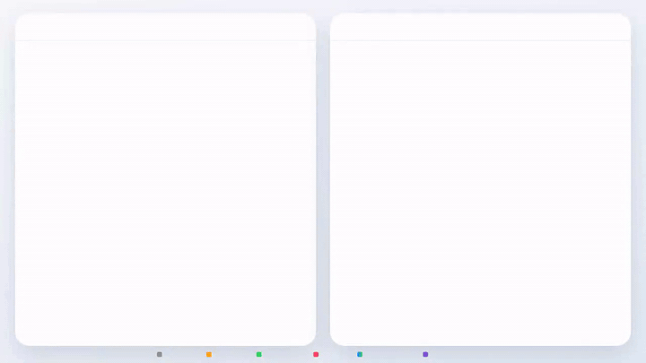

# Epistemic Protocols

> [English](./README.md)

AI와 협업하다 방향이 어긋나면 처음부터 다시 해야 합니다. 이 프로토콜들은 잘못된 방향이 코드나 후속 작업으로 굳어지기 전에, 주로 계획 단계에서 방향을 좌우할 결정들을 미리 끌어내어 직접 확정할 수 있게 돕습니다.

<a name="왜-필요한가"></a>
중요한 내용을 처음부터 빠짐없이 적은 프롬프트라면 프로토콜을 쓰지 않아도 비슷한 결과를 얻을 수 있지만, 모르는 것까지 첫 답을 받기 전에 혼자 다 떠올려 적기가 어렵습니다. 프로토콜을 쓰면 필요한 시점에 AI가 먼저 묻거나 후보를 보여 주고, 여러분은 거기에 답하거나 맞는 것을 고르면 됩니다.

같은 요청을 서브 에이전트 셋에게 그냥 맡길 때와 `/elicit`을 거친 뒤 맡길 때가 어떻게 다른지 비교해 보세요 (클릭하면 영상이 열립니다):

<a href="media/elicit.ko.mp4"></a>

<sub>영상 속 회사·이유·숫자는 각색한 예시이며 실행 결과가 아닙니다.</sub>

다음 주 고객 이탈 회의를 준비할 때 `/inquire`가 닿을 수 있는 자료를 모두 확인해 확인된 사실, 서로 엇갈리는 숫자, 접근하지 못한 자료, 직접 정해야 할 사항을 한 번에 정리해 주는 모습을 확인해 보세요 (클릭하면 영상이 열립니다):

<a href="media/inquire.ko.mp4"></a>

<sub>영상 속 회의·자료·숫자는 각색한 예시이며 실행 결과가 아닙니다.</sub>

## 빠른 시작

### Claude Code

모든 프로토콜을 [`route`](#route) 플러그인과 함께 설치합니다:

```bash
curl -fsSL https://raw.githubusercontent.com/jongwony/epistemic-protocols/main/scripts/install.sh | bash
```

`route`는 에이전트가 대화 맥락에 맞는 프로토콜을 고르고 필요한 시점에 협업 원칙을 참고할 수 있도록 정보를 제공합니다. 아직 실험 단계라 릴리스마다 문구나 훅 구성이 바뀔 수 있으며, 끄고 싶다면 설치 후 `claude plugin disable route@epistemic-protocols`를 실행하면 됩니다. `route`를 꺼도 모든 프로토콜은 그대로 설치되어 있으므로, 작업을 넘기기 전에 `/inquire`를 치거나 어떤 결정을 직접 내려야 할지 막막할 때 `/bound`를 치는 식으로 언제든 명령어를 직접 입력해 쓸 수 있습니다.

### Codex

GitHub에서 추가할 때:

```bash
curl -fsSL https://raw.githubusercontent.com/jongwony/epistemic-protocols/main/scripts/install-codex.sh | bash
```

로컬 저장소 경로에서 추가할 때:

```bash
codex plugin marketplace add /path/to/epistemic-protocols
```

각 점검 단계는 무엇을 결정해야 하고 선택에 따라 무엇이 달라지는지 보여 줍니다. 다만 `codex exec` 같은 비대화형 실행에서는 작업이 이미 시작된 뒤에 이 질문이 표시될 수 있습니다.

<a name="기타-에이전트-도구"></a>
<details>
<summary>기타 에이전트 도구</summary>

Codex marketplace 설정은 [`.agents/plugins/marketplace.json`](./.agents/plugins/marketplace.json)에 있으며, 각 플러그인은 Claude manifest 옆인 `<plugin>/.codex-plugin/plugin.json`에 Codex manifest를 둡니다.

프로토콜 스킬 원본은 각 플러그인 디렉터리의 `<plugin>/skills/<name>/SKILL.md`에 있습니다. 이 레포지토리는 `.agents/skills/` 심링크 뷰를 미리 만들어 두지 않는데, Codex marketplace 탐색 과정에서 플러그인 manifest와 Agent Skills 심링크를 동시에 읽어 같은 스킬이 중복으로 나타날 수 있기 때문입니다.

[Agent Skills](https://agentskills.io/specification) 형식의 디렉터리 구조가 필요한 호스트라면 Codex marketplace 저장소 바깥에 별도로 구성하거나 호스트에 맞는 패키징을 사용하세요. 실행 환경마다 도구 연동 방식(*tool grounding*)에 차이가 있으므로, Claude Code 외의 호스트에서는 충분한 사용 사례가 쌓일 때까지 동작이 달라질 수 있습니다.

</details>

## 프로토콜

<a name="프로토콜이-도움이-되는-순간"></a>
계획을 세울 때뿐만 아니라 작업을 자율 실행에 맡길 때, 결과가 실제 상황에 맞는지 점검할 때, 예전 논의를 다시 찾을 때, 다루어야 할 대상이 제대로 이해됐는지 확인할 때도 프로토콜을 쓸 수 있습니다.

| 명령어 | 언제 쓰나요 |
|--------|-------------|
| [`/inquire`](./aitesis) | 작업에 필요한 맥락이 빠져 있거나 확인되지 않은 가정이 있어, 무엇이 불확실한지 먼저 파악해야 할 때 |
| [`/elicit`](./euporia) | 원하는 것은 대략 있지만, 구체적으로 무엇이 달라져야 하는지 아직 말하기 어려울 때 |
| [`/ideate`](./heuresis) | 선택지를 넓게 열거나, 너무 일찍 좁혀진 후보군을 다시 넓히거나, 예전에 탐색했던 아이디어로 돌아가고 싶을 때 |
| [`/preview`](./proplasma) | 여러 방향 중 하나를 골라야 하는데 결정하기 전에 각 방향이 실제로 어떤 모습일지 먼저 보고 싶을 때 |
| [`/sketch`](./hypotyposis) | 만들고 싶은 것을 미리 말로 설명하기는 어렵지만, 눈으로 보면 바로 알아볼 수 있을 때 |
| [`/fit`](./harmoge) | 목표는 분명한데 설계나 구현이 어디서 들어맞고 어디서 고쳐야 하는지 구체적인 사례로 확인해야 할 때 |
| [`/ground`](./analogia) | 비유나 이전 설계를 새 사례에 적용하거나 일반적인 주장을 실제 사례에 비춰 보면서, 어떤 결론이 따라 나오는지 확인하고 싶을 때 |
| [`/induce`](./periagoge) | 여러 사례에 공통점이 있는 것 같은데 아직 이름이 없거나 기존 이름이 더는 맞지 않을 때 |
| [`/apportion`](./merismos) | 목표를 자율 실행에 맡기기 전에, 한 번의 실행 구간에 맞고 완료 조건이 분명한 단위들로 나누고 싶을 때 |
| [`/contextualize`](./epharmoge) | 결과물이 앞서 말하거나 정한 내용을 놓쳤을 수 있거나, 실제로 쓰일 상황에 맞지 않을 수 있을 때 |
| [`/bound`](./horismos) | 작업이 무엇에 기대고 있는지 — 무엇이 누구의 판단으로 정해졌고, 어떤 결정은 직접 내리거나 맡겨야 할지 — 아직 분명하지 않을 때 |
| [`/recollect`](./anamnesis) | 전에 논의한 기억은 나지만 어느 대화였는지, 무엇이라고 불렀는지 짚을 수 없을 때 |
| [`/grasp`](./katalepsis) | 눈앞의 코드나 문서·결과물을 따라가기 어렵거나, 이해한 것 같아도 확신이 없을 때 |
| [`/conduct`](./hyphegesis) | 작업이 여러 갈래로 나뉘는데 무엇을 따로 돌릴 수 있는지, 어떤 순서가 중요한지, 결과를 어떻게 합쳐 어디로 보낼지, 언제 멈출지 분명하지 않을 때 |

프로토콜은 정해진 순서로 실행할 필요가 없습니다. 지금 막힌 부분에 맞는 명령어를 골라 쓰고, 상황에 따라 자유롭게 조합하면 됩니다.

<details>
<summary>프로토콜을 실행하고 나면 무엇이 남나요</summary>

| 명령어 | 프로토콜 | 끝나면 |
|--------|----------|--------|
| [`/inquire`](./aitesis) | [Aitesis](./aitesis) | 무엇이 어디서 확인됐는지, 무엇이 약하거나 닿지 못한 근거에 기대는지, 무엇이 직접 정할 몫인지 알아볼 수 있습니다 |
| [`/elicit`](./euporia) | [Euporia](./euporia) | 정리된 내용을 보고 "이 정도면 내 뜻이 맞다"고 말할 수 있습니다. 결정마다 근거가 된 내 말이 남고, 아직 정하지 않은 사항도 그대로 전달됩니다 |
| [`/ideate`](./heuresis) | [Heuresis](./heuresis) | 각 관점과 그 아래 판 갈래, 후보마다 나온 출처, 아직 탐색하지 않은 영역과 보류한 항목까지 아이디어 지도를 한 장으로 훑어보고, 무엇도 미리 고르거나 순위 매기지 않은 채 다음 단계로 가져갑니다 |
| [`/preview`](./proplasma) | [Proplasma](./proplasma) | 각 방향이 내 목적에 무엇을 뜻하는지 — 직접 본 시제품, 설명, 내 이야기, 증거 중 무엇에 기대는지와 함께 — 말할 수 있고, 어느 쪽을 택할지 정합니다 |
| [`/sketch`](./hypotyposis) | [Hypotyposis](./hypotyposis) | 직접 확인한 버전을 가리켜 "이 목적에는 이 형태가 맞다"고 말할 수 있고, 선택한 버전과 지나친 버전들이 어디에 있는지 확인합니다 |
| [`/fit`](./harmoge) | [Harmoge](./harmoge) | 내가 확정한 사례들, 지금까지 모은 모든 사례에서 대상이 어떻게 동작하는지, 아직 열려 있는 경계를 한눈에 보고 목적에 충분한지 판단할 수 있습니다 |
| [`/ground`](./analogia) | [Analogia](./analogia) | 각 결론의 근거와 한계를 짚고, 무엇을 확인해 무엇을 찾았는지, 무엇이 그 결론을 깨뜨릴지, 그리고 성립하는지·막혔는지·아직 미정인지 구분할 수 있습니다 |
| [`/induce`](./periagoge) | [Periagoge](./periagoge) | 사례들이 공유하는 공통점에 이름을 붙이고, 어떤 사례를 품고 어떤 사례를 빼는지 말할 수 있으며, 그것이 내 목표에 맞는지 판단할 수 있습니다 |
| [`/apportion`](./merismos) | [Merismos](./merismos) | 단위별 완료 확인 조건과 감수할 빈틈, 보류한 판단이 담긴 계획을 내 것으로 확정합니다. 실행 전에 직접 정해야 할 것은 먼저 정하고, 나머지는 실행이 끝날 때 한 번에 돌려받습니다 |
| [`/contextualize`](./epharmoge) | [Epharmoge](./epharmoge) | 놓쳤던 내용과 그것이 지금 결과에 뜻하는 바를 다시 확인하고, 이미 정한 내용을 잘못 적용한 곳은 바로잡아 다시 읽어 보며, 직접 판단할 사항은 제안과 함께 돌려받습니다 |
| [`/bound`](./horismos) | [Horismos](./horismos) | 작업이 무엇을 정해진 것으로 다루는지 그 근거와 판단 주체까지 확인하고, 열린 항목은 모두 AI가 맡은 선택이나 제안 표시가 붙은 채로 채워져 한눈에 볼 수 있습니다 |
| [`/recollect`](./anamnesis) | [Anamnesis](./anamnesis) | 찾던 과거의 대화나 여러 대화에 걸친 작업 흐름·주제·개념을 복원합니다. 복원한 이야기는 문장마다 원래 기록을 다시 열어 확인할 수 있으며, 과거에 있었던 일이라는 사실과 지금도 유효한지는 구분해 파악합니다 |
| [`/grasp`](./katalepsis) | [Katalepsis](./katalepsis) | 실제 자료와 대조해 함께 만든 이해 지도를 바탕으로 지금의 이해가 목적에 맞다고 말할 수 있고, 아직 남은 확인은 무엇으로 마칠지 파악합니다 |
| [`/conduct`](./hyphegesis) | [Hyphegesis](./hyphegesis) | 여러 갈래가 어떤 순서로 실행되고 어떻게 합쳐지며 어디서 멈추고 결과가 어디로 가는지 말할 수 있고, 맡긴 것과 직접 쥔 것을 구분해 작업 방식을 내 것으로 삼습니다 |

</details>

<a name="유틸리티"></a>
<a name="route"></a>
<details>
<summary>Route</summary>

Claude Code용 유틸리티 플러그인 설치 방법은 [빠른 시작](#claude-code)을 참고하세요.

**[Route](./route)**

> **실험 단계.** 훅 구성과 주입되는 문구는 릴리스마다 바뀔 수 있습니다 — 기대기 전에 [route/README_ko.md](./route/README_ko.md)를 확인하세요.

대화 맥락에 따라 프로토콜을 연결합니다. 세션 시작 훅은 컨텍스트 에포크마다 한 번씩 컨텍스트 앞부분에 먼저 써야 할 두 프로토콜 — 맥락을 모으기 전에는 `/inquire`, 의도가 불명확할 때는 `/elicit`(플러그인의 `purpose.md`) — 과 각 프로토콜의 설명이 적힌 설치 목록, 그리고 [premise](./premise) 색인을 넣어 둡니다. 메인 대화의 에이전트는 프롬프트를 받았을 때나 턴 중간에 그 턴 안에서 바로 판단하며, fork를 포함해 위임받은 하위 에이전트는 프로토콜을 호출하지 않습니다. 덕분에 어떤 프로토콜이 있는지 일일이 기억하지 않아도 대화에서 드러나는 빈틈을 해결할 프로토콜을 바로 만날 수 있습니다. 에이전트는 목적에 명시된 상황이면 `/inquire`나 `/elicit`을 부르고, 그 밖의 빈틈은 각 프로토콜의 설명에 비춰 판단하며, 직접 판단해야 할 사항은 호출된 프로토콜이 각 단계에서 묻습니다. Route 자체의 실행 명령어는 따로 없으므로, 쓰고 싶은 프로토콜을 이미 알고 있다면 해당 프로토콜의 명령어를 직접 입력하세요.

</details>

<a name="검증이-확인하는-것"></a>
<details>
<summary>검증이 확인하는 것</summary>

검증 장치마다 확인하는 것이 다르고, 각자 어디서 멈추는지 알아 두면 도움이 됩니다.

- **Lean 증명** — 프로토콜의 계약은 `SKILL.md` 안에 Lean 모델로도 적혀 있습니다. Lean은 그 모델에 대해 적힌 성질이 모델이 선언한 가정 아래에서 성립하는지 확인합니다. 모델이 열어 둔 판단은 그 가정에 속하며, 증명되는 대상이 아닙니다. 프로토콜의 [`lean/EpistemicProtocols/<Protocol>/Theorems.lean`](./lean/EpistemicProtocols)에 그 모델에 대해 적고 증명한 성질이 있습니다.
- **런타임 증거** — 컨트리뷰터 스킬 [`/realize`](./.claude/skills/realize/SKILL.md)는 프로토콜을 실제 세션에서 실행해, 선언된 단계가 실제로 일어나는지에 대한 증거를 자동 검사와 대화 기록 검토로 모읍니다.
- **정적 검사** — [`static-checks.js`](./scripts/static-checks/static-checks.js)는 파일의 구조를 확인합니다: 필요한 섹션, 이름과 참조의 일관성, 버전 일치.

이 가운데 어느 것도 프로토콜을 쓴 뒤에 일어나는 일, 예를 들어 재작업이 줄었는지는 재지 않으며, 일부러 그렇게 둡니다. 프로토콜이 얼마나 도움이 되는지는 사람마다 아직 모르는 것이 무엇인지와, 계속 좋아지는 모델에 따라 달라지기 때문입니다. 실행 한 번이 보여 줄 수 있는 것은 처음부터 적혀 있어서가 아니라 AI가 묻거나 제시해서 대화에 들어온 결정이 무엇인지입니다. 컨트리뷰터 스킬 [`/outcome`](./.claude/skills/outcome/SKILL.md)은 같은 요청을 프로토콜을 쓸 때와 쓰지 않을 때 각각 실행해 그 결정들을 나온 구절과 함께 나열합니다.

</details>

<a name="컨트리뷰터를-위해"></a>
<details>
<summary>컨트리뷰터를 위해</summary>

[ONBOARDING.md](./ONBOARDING.md)부터 시작하세요. 새 Claude Code 세션에 파일 전체를 붙여넣으면 Claude가 온보딩 버디가 되어 환경 셋업, 핵심 문서, 컨트리뷰션 워크플로우를 안내합니다.

아키텍처는 [CLAUDE.md](./CLAUDE.md), 협업의 바탕이 되는 원칙은 [premise/](./premise/)에서 살펴보세요.

프로젝트를 소개하는 공개 문구를 고칠 때는 [co-change.md](./docs/co-change.md)의 Mission/vision wording change 행을 따르세요.

### Greek Codex

| 프로토콜 | 그리스어 | 의미 |
|----------|---------|------|
| Katalepsis | κατάληψις | 움켜잡음 (이해) |
| Horismos | ὁρισμός | 경계 짓기 |
| Aitesis | αἴτησις | 요청, 질의 |
| Analogia | ἀναλογία | 유비, 유추 |
| Periagoge | περιαγωγή | 돌려세움, 방향 전환 |
| Euporia | εὐπορία | 통로, 자원성 |
| Merismos | μερισμός | 부분으로 나눔 |
| Epharmoge | ἐφαρμογή | 적용, 맞춤 |
| Anamnesis | ἀνάμνησις | 상기, 회상 |
| Hyphegesis | ὑφήγησις | 앞서 이끌기, 안내 |
| Proplasma | πρόπλασμα | 예비 모형, 첫 거푸집 |
| Hypotyposis | ὑποτύπωσις | 개요, 밑그림 |
| Harmoge | ἁρμογή | 맞춰 이음, 접합 |
| Heuresis | εὕρεσις | 발견, 찾아냄 |

</details>

## 감사의 말

- [@yolohyo](https://github.com/yolohyo) — Comment-review 코멘트 라이프사이클 UX 설계 기여 (이 스킬은 프로토콜 합성을 걷어낸 순수 기질 플러그인으로 [cc-plugin](https://github.com/jongwony/cc-plugin)에 이관되었습니다)
- [@zzsza](https://github.com/zzsza) — Onboard 퀴즈 기반 참여형 UX 설계 기여

## 라이선스

MIT
