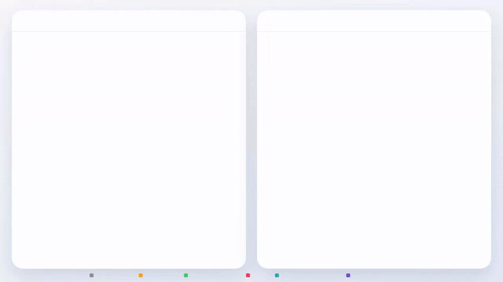

# /inquire — Aitesis (αἴτησις)
<a name="aitesis--inquire-αἴτησις"></a>

> [한국어](./README_ko.md)

## What is /inquire?

<a name="what-is-aitesis"></a>
### Definition

Aitesis (Greek αἴτησις, "a requesting") is a protocol for checking the facts and open choices a task rests on. It makes the AI gather everything it can reach on its own, state what it reached and what it could not reach for each uncertainty, and hand back what only you can settle.

<a name="when-to-use"></a>
<a name="the-core-problem"></a>
### The problem

People often stop looking once a plausible story forms, and AI often proceeds on silent guesses when domain context is missing, requirements go unchecked, or setup details are assumed. Before relying on an unchecked fact, run `/inquire`. The AI shows what the records establish and flags choices it thinks are yours. You can correct that reading.

### The result

You get a clear breakdown of what your task rests on, ordered by what an answer would change most:

- **Settled** — facts fixed by a cited source or your own words. A commit or recorded decision is cited as the fact that the decision was made, while a choice you still hold stays open until your own words settle it.
- **Evidence is incomplete** — findings where the evidence falls short, with the gap stated.
- **Unreached** — unknowns nothing reachable could settle, with the sources tried and those that could not be reached.
- **Unasked-for findings** — anything relevant discovered along the way that answers none of the raised uncertainties, shown on its own line.

Where sources conflict, the AI names what conflicts with what. Where a decision blocks further checking, it names what waits on that decision. The run finishes its pass and continues without locking your turn: you can answer, correct a reading, point to a missed source, or dismiss an item to trigger another pass, or say nothing and leave the current breakdown standing.

<a href="../media/inquire.en.mp4"></a>

<sub>`/inquire` in use (click for the video). Values in the clip are illustrative, not a run result.</sub>

<a name="install"></a>
## Install

```
claude plugin marketplace add https://github.com/jongwony/epistemic-protocols
claude plugin install aitesis@epistemic-protocols
```

<a name="usage"></a>
<a name="the-solution"></a>
## Usage

```
/inquire [your current task or context]
```

After you run `/inquire`, the AI lists what your task leaves uncertain and checks every file, record, or read-only check it can run on its own without changing existing state. If it creates a scratch copy or temp file just to look, it removes it afterwards. Anything that would change existing state or needs someone's permission is not run; instead, the AI names it and tells you what it needs.

<details>
<summary>Examples of uncertainties</summary>

<a name="uncertainty-identification"></a>
Uncertainties are identified per task rather than from a fixed list:

| What the work rests on | Example |
|------------------------|---------|
| A fact the AI can look up | "Which database schema version does this service run against?" — read from the migrations |
| A fact only the user holds | "Is the staging cluster still shared with the other team?" |
| A decision further collection waits on | "Which payment provider will this service use? The AI has read provider A's public docs and the existing client; provider B's sandbox behaviour is visible only from an account that exists once you choose B." |

</details>

<details>
<summary>How it works and compares to other protocols</summary>

<a name="protocol-flow"></a>
### Protocol Flow

```
Collection   → Push each uncertainty through every source the AI can reach on its own; name what it tried and what it could not reach
Completion   → Collection has reached everything it can; what is open stays open and is not settled
Relay        → Hand back what is open — findings with their shortfalls, conflicts named, blocking decisions named — show detections, and proceed
Answer       → Read whole: settle, correct, point to a source, "I don't know either", or dismiss — one that bears on the run reopens collection and a new completion
```

**Evidence over Inference over Detection**: From Greek αἴτησις (a requesting), Aitesis infers what the prospect leaves uncertain rather than detecting via a fixed taxonomy (`Inference > Detection`), then pushes each uncertainty through every reachable source to gather evidence rather than substituting inference (`Evidence > Inference`). The beneficiary is the user's epistemic state, and the AI's collection is its instrument.

<a name="difference-from-other-protocols"></a>
### Difference from Other Protocols

| Protocol | Mode | Type Signature |
|----------|------|---------------|
| **Aitesis** | **INQUIRE** | **`ContextInsufficient → SufficientContext`** |
| Proplasma | PREVIEW | `DirectionUnrecognizable → DirectionalContrast` |

Aitesis collects what the AI lacks and names what only the user holds (heterocognitive: "what can I reach, and what is yours?"). Proplasma (`/preview`) is the neighbor on the direction axis: Aitesis supplies missing facts and names the user's unknowns, while Proplasma materializes direction futures as discard-committed placeholder contrast when candidates are known but unrecognizable from descriptions.

<a name="protocol-precedence"></a>
### Protocol Precedence

```
Aitesis → Analogia → Katalepsis
```

Aitesis runs early to exhaust what the AI can collect for the work ahead. Analogia, later in the order, collects what its own audit rests on.

When the context is already fully specified or you ask to proceed without verification, AI-guided activation skips Aitesis; invoking `/inquire` directly always runs collection.

</details>

<a name="author"></a>
## Author

Jongwon Choi (https://github.com/jongwony)
