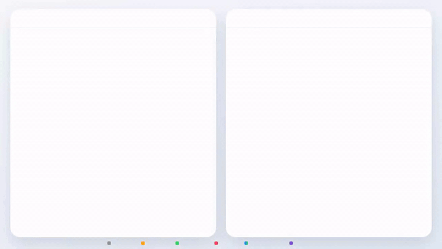

# /inquire — Aitesis (αἴτησις)
<a name="aitesis--inquire-αἴτησις"></a>

[English](README.md)

<a name="inquire란"></a>
<a name="aitesis란"></a>
<a name="사용-시기"></a>
<a name="핵심-문제"></a>

작업에 필요한 사실을 먼저 확인하고 싶을 때 Claude Code에서 `/inquire`를 쓴다. AI가 접근할 수 있는 파일과 기록을 살펴보고, 무엇을 확인했는지, 무엇이 아직 불확실한지, 사용자가 직접 결정할 일이 무엇인지 알려준다.

## 사용 예시

프로젝트 회의 자료를 준비하는데 출시일이 여러 문서에 나와 있다. Claude Code에 다음과 같이 입력한다.

```text
/inquire 다음 주 프로젝트 점검 회의에 쓸 발표 자료를 만들려고 해.
```

AI는 다음과 같이 답할 수 있다.

> - **확인한 사실** — 회의 초대장에 출시 일정이 주요 안건으로 적혀 있어.
> - **서로 다른 기록** — 프로젝트 계획서에는 출시일이 6월 12일, 지난 회의록에는 6월 19일로 적혀 있어. 어느 날짜로 확정했는지는 두 문서에서 확인할 수 없었어.
> - **확인하지 못한 항목** — 최신 가입자 수는 내가 접근할 수 없는 대시보드에 있어.
> - **사용자가 정할 사항** — 발표 자료에 비용 추정치도 넣을까, 아니면 일정에 집중할까?

AI는 작업에 영향이 큰 항목부터 보여준다. 확인한 사실에는 출처를 붙이고, 확인할 수 없었던 이유도 알려준다. 찾아보는 중에 작업에 도움이 되는 다른 사실을 발견하면 함께 짚어 준다. 답을 주거나, AI가 기록을 잘못 해석한 부분을 바로잡거나, 다른 자료를 알려주면 다시 확인할 수 있다. 미정인 항목을 그대로 두고 넘어가도 된다.

<a href="../media/inquire.ko.mp4"></a>

<sub>미리보기를 누르면 `/inquire` 시연 영상을 볼 수 있다. 영상 속 값은 시연용이다.</sub>

<a name="install"></a>
<a name="설치"></a>
## 설치 및 실행

터미널에서 다음 명령을 실행한다.

```sh
claude plugin marketplace add https://github.com/jongwony/epistemic-protocols
claude plugin install aitesis@epistemic-protocols
```

<a name="사용법"></a>
<a name="해결책"></a>
설치한 뒤 Claude Code에서 `/inquire` 뒤에 지금 하려는 일을 적는다.

```text
/inquire [지금 하려는 일]
```

<details>
<summary>AI가 확인하는 범위</summary>

AI는 작업에서 확인이 필요한 부분을 추려낸 뒤, 기존 파일이나 설정을 바꾸지 않는 범위에서 자료를 살펴본다. 확인에 임시 사본이 필요하면 만든 뒤 확인을 마치고 지운다. 권한이나 설정 변경, 사용자의 결정이 필요한 경우에는 어떤 항목을 확인하려면 무엇이 필요한지 알려준다.

다른 상황에서 어떻게 작동하는지는 [시나리오 모음](docs/scenarios.md)에서 볼 수 있다.

</details>

<details>
<summary>다른 명령과의 차이</summary>

작업에 필요한 사실부터 확인해야 할 때는 `/inquire`를 쓴다. 이미 후보가 있고 각 방향의 간단한 시안을 보고 고르고 싶을 때는 Proplasma(`/preview`)를 쓴다.

Claude Code가 프로토콜을 자동으로 고를 때는 필요한 정보가 이미 충분하거나 사용자가 확인 없이 진행해 달라고 하면 `/inquire`를 건너뛸 수 있다. 사용자가 `/inquire`를 직접 입력하면 확인을 시작한다.

</details>

<a name="저자"></a>
## 작성자

[Jongwon Choi](https://github.com/jongwony)
