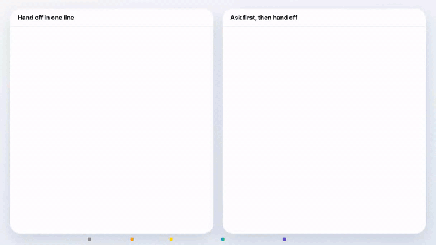

# /elicit — Euporia (εὐπορία)
<a name="euporia-εὐπορία"></a>

> [한국어](./README_ko.md)

## What is /elicit?

### Definition

Euporia (Greek εὐπορία, "good passage") is a protocol for turning a rough direction into an intent you can recognize as yours. It surfaces the open decisions your request turns on — drawn from your words, your files, rules, past sessions, and the subject area itself — and records only what your own words settle.

<a name="when-to-invoke"></a>
### The problem

Without it, a request that gives a direction but leaves the intended result unclear forces the AI to guess what should change and fill in the blanks on its own. Use `/elicit` when your request gives a direction but leaves the intended result unclear. If the AI suggests `/elicit`, you can accept or decline.

<a name="overview"></a>
### The result

Each round hands back your current intent without holding your turn:

- **Your words vs. AI proposals** — every recorded choice is marked with whether it came from your own words or an AI proposal. A choice you gave stays put until your own words change it, and an AI proposal counts as adopted only after it was shown to you as a proposal and you took it.
- **Unsettled items carried forward** — you do not need to answer every question. Whatever you leave open stays explicitly open rather than closing to a silent default.

You decide when the intent is aligned enough. Even before that, you can stop or move on to other work at any time; the last read-back stays standing as your intent.

<a href="../media/elicit.en.mp4"></a>

<sub>`/elicit` in use (click for the video). Values in the clip are illustrative, not a run result.</sub>

## Install

See the root [README](../README.md) for installation.

## Usage

Type `/elicit` with your request.

On the first response, the AI reads back your intent as it understands it, cites where each part came from, and surfaces the open decisions along with what leaving each one open would change. When the AI suggests `/elicit` on its own, that first response is a proposal you can confirm or decline. You can reply in your own words, pick from what the AI showed, add a new decision point, reject one that does not belong, or say right away that the intent is aligned enough.

The AI may also take reversible steps forward based on a stated judgment, telling you how it read your words, what it decided on what basis, and how far it went; anything that cannot be undone waits for your approval.

<details>
<summary>Name, type, and relation to other protocols</summary>

<a name="name"></a>
### Name

Greek εὐπορία — literally "good passage" (εὖ "well" + πόρος "way") — names the resourcefulness toward resolution that emerges from aporia (ἀπορία, "no way through"). Plato's later dialectic threads aporia and euporia as paired moments of inquiry; the protocol borrows the resolving-passage structure.

<a name="type"></a>
### Type

```
(AbstractAporia, Hybrid, REVERSE-INDUCE-CYCLE, IntentSeed)
  → ResolvedEndpoint
```

What the Lean contract proves is that turns without a word of yours are never the source of a recorded value.

### Relation to other protocols

Euporia stands in directional dual relation to Periagoge (`/induce`): Periagoge ascends from concrete instances to a shared abstraction (bottom-up), while Euporia descends from an intent to the decision coordinates it turns on (top-down). The two compose as orthogonal directions of the same dialectic (informal direction-orthogonality, not a formal categorical limit/colimit duality).

An intent whose axis is already fixed may be better served by an axis-specific protocol, and a set of cases whose shared abstraction you are forming or reconsidering, by Periagoge (`/induce`).

<a name="components"></a>
### Components

- `skills/elicit/SKILL.md` — protocol definition (a Lean 4 formal block that elaborates, prose, rules)
- `.claude-plugin/plugin.json` — plugin manifest

</details>
