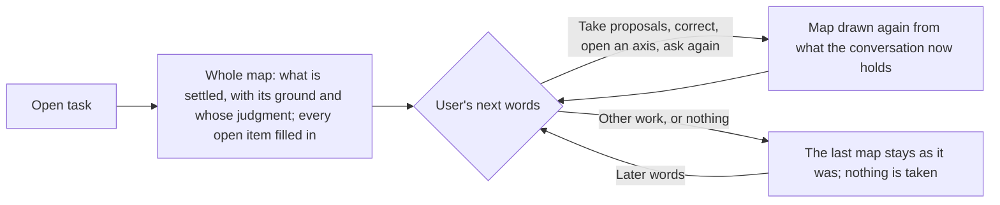

# /bound — Horismos (ὁρισμός)
<a name="horismos--bound-ὁρισμός"></a>

> [한국어](./README_ko.md)

## What is /bound?

### Definition

Horismos (Greek ὁρισμός, "a bounding") is a protocol for mapping the decisions a task rests on before work proceeds. It shows what is already settled and by whose judgment, and fills in every open item with the AI's choice where you entrusted discretion or with a marked AI proposal.

### The problem

Often the urge to delegate comes before a fixed goal or knowledge of the decisions involved. Without a visible map of those decisions, you cannot easily tell which parts already have a source-defined answer, which open questions have thin ground, or which choices to keep versus entrust to the AI. Reach for `/bound` when you want to see and adjust that decision boundary at the depth you choose.

### The result

You get the current map, at the depth you chose:

- **What is settled** — which parts already have a source-defined answer, pointers to the records that settled them, and whose judgment they rest on.
- **Every open item filled in** — filled with the AI's own choice where you entrusted discretion, or with the AI's marked proposal (flagged when its ground is thin), alongside why it matters, what it depends on, the alternatives, what follows from each, and any objections the AI recorded.
- **What stays yours** — returning the map adopts nothing on its own; an AI proposal counts as taken only after it was shown to you as the AI's with its evidence and any objections, and you took it in your own words.

<a name="install-and-use"></a>
## Install

```bash
claude plugin marketplace add https://github.com/jongwony/epistemic-protocols
claude plugin install horismos@epistemic-protocols
```

## Usage

```text
/bound [the task or concern whose boundaries need defining]
```

The AI drafts a map of the whole decision structure from the available context, showing why each decision matters and what it depends on. Where it needs material or evidence to draw the map, it gathers it or runs checks in a scratch space (anything that cannot be undone waits for your authorization), and tells you how it read your words, what it judged on what basis, and how far it went.

For example, a project map might show that the audience is already chosen (because you said so), that the data handling approach is an AI proposal on thin ground (because the vendor's terms were unreachable), and that the rollout date is also an AI proposal. You can keep the audience, rule out external transmission, entrust comparing the remaining approaches to the AI, and ask again about the date.

Each round returns the updated map without holding your turn, and after a return the session goes on to the next move you already named. You can inspect any item at whatever depth you like, take a proposal in your own words, reframe a question, or move on to other work. Opening an item does not adopt its proposal or force you to review every other item.

<details>
<summary>How the map updates across turns</summary>



The result is `BoundaryUndefined → DefinedBoundary`: the current map with each decision's disposition, every item still open with why it matters and who settles it, what the map did not look at, the AI's recorded objections, and pointers to the settling records. Checking a proposal further, and the downstream work the map is for, are left to the steps that follow.

</details>

<details>
<summary>Contract and verification</summary>

<a name="contract-and-verification"></a>
- [SKILL.md](skills/bound/SKILL.md) defines provisional discovery, progressive examination, source-bound settlement, and a map returned every round with every open item filled in and no answer owed — as a Lean 4 block that elaborates.
- [Round composition](skills/bound/references/round-composition.md) supplies occasion-specific presentation rules.
- [Repository verification](../AGENTS.md#verification) gives the contributor workflow. For this plugin's Lean contract, static, and packaging checks, run these from the repository root, sequentially:

```bash
node scripts/static-checks/lean-contract.js check .
node scripts/static-checks/static-checks.js .
node --test scripts/static-checks/static-checks.test.mjs
node --test scripts/package.test.js
```

Static checks establish structural properties. Whether a dialogue makes an unfamiliar decision structure recognizable and respects the user's chosen depth requires inspecting actual interaction traces.

</details>
