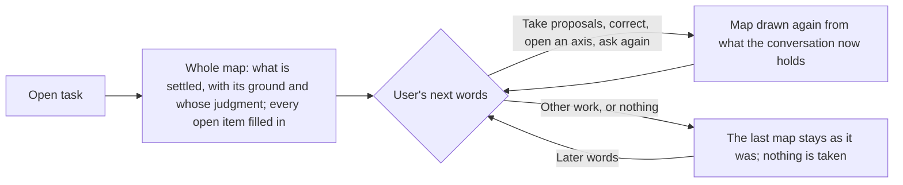

# Horismos — /bound (ὁρισμός)

See what a task treats as settled — on what ground and by whose judgment — with every open item filled in as the AI's choice or its marked proposal.

> [한국어](./README_ko.md)

A request to delegate can precede both a fixed goal and knowledge of the decisions involved. `/bound` starts by drafting the relevant whole structure from the available context. It shows why a decision matters, what it depends on, which parts already have a source-defined answer and whose judgment settled them, and it fills in every part still open: with the AI's own choice where the user entrusted it, and otherwise with the AI's proposal, marked as such — also where its ground is thin, which the map then says. Beside a filling, the map shows the alternatives that bear on that decision, with what follows from each.



The user can open any axis, inspect its proposed content, and change the framing. Different axes can receive different depths of examination. Opening one does not adopt its proposal or require reviewing every other one. Each round returns the map and waits for nothing: the user can keep what is settled, take any of the AI's proposals in their own words, or ask again about any item, and the next round draws the map again from what the conversation now holds. Returning the map takes nothing by itself; after a return, the session goes on to the next move the user declared. Each round gathers what the map itself needs — collecting material and evidence, or running what that takes in a scratch space; checking a proposal further, and the work the map is for, are left to what follows — and comes back with an account of how the user's words were read, what was judged on what basis, and how far it went; anything that cannot be undone waits for the authorization it needs. Words saying the user is done are read like any other answer. Turning to other work closes nothing. The user's words are read as taking an AI proposal only where that proposal was shown as the AI's, with its evidence and the AI's objections, if it had any, before those words.

For example, a project map might show that the audience is already chosen (the user said so), that the data handling approach is the AI's proposal on thin ground (the vendor's terms were not reachable), and that the rollout date is also the AI's proposal. The user can keep the audience, rule out external transmission, entrust comparing the approaches that remain, and ask again about the date. The map then redraws the affected items. A map shows the boundary at the depth it was examined; it does not silently resolve every open project question.

The result is `BoundaryUndefined → DefinedBoundary`: the current map with each decision's disposition — who put it forward and how it stood — every item still open, with why it matters and who settles it — by this run's word or an earlier decision — what the map did not look at, the AI's recorded objections, and pointers to the records that settled it. The AI's fillings, and the marks on those whose ground is thin, are shown in the text of the round that returns the map. Proposal work leaves selection with its holder; entrusted discretion permits choice within the actual grant.

## Install and use

```bash
claude plugin marketplace add https://github.com/jongwony/epistemic-protocols
claude plugin install horismos@epistemic-protocols
```

```text
/bound [the task or concern whose boundaries need defining]
```

## Contract and verification

- [SKILL.md](skills/bound/SKILL.md) defines provisional discovery, progressive examination, source-bound settlement, and a map returned every round with every open item filled in and no answer owed — as a Lean 4 block that elaborates.
- [Round composition](skills/bound/references/round-composition.md) supplies occasion-specific presentation rules.
- [Repository verification](../AGENTS.md#verification) gives the contributor workflow. For this plugin's Lean contract, static, and packaging checks, run these from the repository root, sequentially:

```bash
node .claude/skills/verify/scripts/lean-contract.js check .
node .claude/skills/verify/scripts/static-checks.js .
node --test .claude/skills/verify/scripts/static-checks.test.mjs
node --test scripts/package.test.js
```

Static checks establish structural properties. Whether a dialogue makes an unfamiliar decision structure recognizable and respects the user's chosen depth requires inspecting actual interaction traces.
