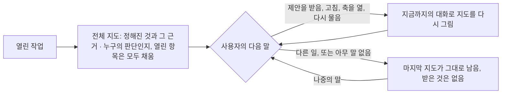

# /bound — Horismos (ὁρισμός)
<a name="horismos--bound-ὁρισμός"></a>

> [English](./README.md)

## 정의

Horismos(그리스어 ὁρισμός, "경계 짓기")는 작업을 진행하기 전에 그 작업이 어떤 결정들에 기대고 있는지 전체 지도를 그리는 프로토콜입니다. 무엇이 어떤 근거와 누구의 판단으로 이미 정해졌는지 보여 주고, 아직 열린 항목은 모두 여러분이 맡긴 재량에 따른 AI의 선택이나 제안 표시가 붙은 안으로 채워 보여 줍니다.

## 문제

위임하고 싶다는 생각은 목표가 완전히 굳거나 어떤 결정들이 필요한지 다 파악하기 전에도 생깁니다. 결정 구조가 눈에 보이지 않으면 어느 부분이 이미 출처에 따라 정해졌는지, 어느 항목의 근거가 얇은지, 무엇을 직접 챙기고 무엇을 AI에게 맡길지 가늠하기 어렵습니다. 원하는 깊이만큼 결정 경계를 확인하고 조정하고 싶을 때 `/bound`를 씁니다.

## 결과

여러분이 선택한 깊이에서 그린 현재 지도를 받습니다:

- **정해진 것** — 출처에 따라 이미 답이 정해진 부분과 그 기록을 가리키는 참조, 그리고 누구의 판단으로 정해졌는지가 표시됩니다.
- **모두 채워진 열린 항목** — 여러분이 재량을 맡긴 곳은 AI의 선택으로, 그 밖의 곳은 AI의 제안(근거가 얇으면 얇다고 함께 표시)으로 빈칸 없이 채워집니다. 각 항목 옆에는 왜 필요한지와 무엇에 의존하는지, 다른 대안들과 각각을 택했을 때 달라지는 점, AI가 기록한 반대 근거가 함께 붙습니다.
- **내 결정권의 유지** — 지도를 돌려받는 것만으로는 어떤 제안도 채택되지 않습니다. AI의 제안이라고 근거·반대 근거와 함께 먼저 표시된 뒤 여러분이 자기 말로 받아들였을 때만 채택으로 읽습니다.

<a name="설치와-사용"></a>
## 설치

```bash
claude plugin marketplace add https://github.com/jongwony/epistemic-protocols
claude plugin install horismos@epistemic-protocols
```

## 사용법

```text
/bound [경계를 정의할 작업이나 관심사]
```

`/bound`를 실행하면 AI는 주어진 맥락에서 작업과 관련된 결정 구조 전체의 초안 지도를 그리고, 각 결정이 왜 필요하며 무엇에 의존하는지 보여 줍니다. 지도를 그리는 데 필요한 자료나 근거는 스스로 모으거나 스크래치 공간에서 돌려 보며(되돌릴 수 없는 작업은 승인을 기다립니다), 여러분의 말을 어떻게 읽었고 무엇을 어떤 근거로 어디까지 판단했는지 함께 설명합니다.

예를 들어 프로젝트 지도에 대상 사용자는 이미 정해졌고(여러분이 앞서 그렇게 말함), 데이터 처리 방식은 근거가 얇은 AI의 제안이며(업체 약관을 읽지 못함), 배포일도 AI의 제안이라고 표시될 수 있습니다. 여러분은 대상 사용자를 그대로 두고, 외부 전송은 제외하고, 남은 방식들을 비교하는 일은 AI에게 맡기고, 배포일은 다시 물을 수 있습니다.

매 라운드는 답을 기다리지 않고 갱신된 지도를 돌려주며, 지도를 돌려준 뒤에는 여러분이 앞서 밝힌 다음 일로 넘어갑니다. 원하는 항목만 골라 원하는 깊이만큼 열어 보고, 제안을 자기 말로 받아들이거나 틀을 고치거나 다른 작업으로 넘어가면 됩니다. 한 항목을 열어 봤다고 해서 그 제안을 채택한 것으로 치거나 나머지 항목을 모두 검토해야 하는 것은 아닙니다.

<details>
<summary>대화 흐름에 따른 지도 갱신</summary>



결과는 `BoundaryUndefined → DefinedBoundary`입니다. 결정마다 누가 냈고 어떻게 섰는지 달린 현재 지도, 아직 열린 항목마다 왜 필요한지와 누가 정하는지, 지도가 보지 않은 영역, AI가 기록한 반대 근거와 결정 기록의 참조를 함께 전달합니다. 제안을 더 검증하는 일과 지도를 바탕으로 실제로 수행할 본 작업은 뒤따르는 단계에 맡깁니다.

</details>

<details>
<summary>계약과 검증</summary>

<a name="계약과-검증"></a>
- [SKILL.md](skills/bound/SKILL.md)는 잠정 구조의 발견, 점진적 검토, 출처에 따른 결정, 그리고 라운드마다 열린 항목을 모두 채운 지도를 돌려주고 답을 기다리지 않는 흐름을 정의합니다. 이 정의는 elaborate 되는 Lean 4 블록입니다.
- [라운드 구성](skills/bound/references/round-composition.md)은 특정 상황에서 필요한 제시 규칙을 담습니다.
- [저장소 검증 지침](../AGENTS.md#verification)에 기여자용 작업 흐름이 있습니다. 이 플러그인의 Lean 계약 검사, 정적 검사, 패키징 검증은 저장소 루트에서 다음 명령을 순서대로 실행합니다.

```bash
node scripts/static-checks/lean-contract.js check .
node scripts/static-checks/static-checks.js .
node --test scripts/static-checks/static-checks.test.mjs
node --test scripts/package.test.js
```

정적 검사는 구조적 속성을 확인합니다. 실제 대화가 낯선 결정 구조를 알아볼 수 있게 하고 사용자가 선택한 깊이를 지키는지는 실제 상호작용 기록을 읽어 검증해야 합니다.

</details>
