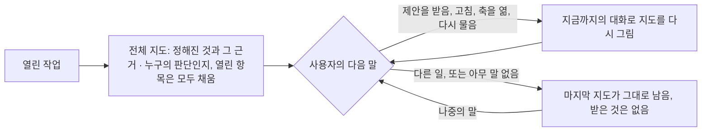

# Horismos — /bound (ὁρισμός)

작업이 무엇을 정해진 것으로 다루는지 — 어떤 근거로, 누구의 판단으로 — 보고, 열린 항목은 모두 AI 가 맡은 선택이나 표시된 제안으로 채워진 채 받습니다.

> [English](./README.md)

위임하고 싶다는 의도는 목표가 확정되거나 어떤 결정이 필요한지 알기 전에도 생깁니다. `/bound`는 주어진 맥락에서 관련 구조 전체의 초안을 먼저 만듭니다. 각 결정이 왜 필요한지, 무엇에 의존하는지, 어떤 부분이 출처에 따라 이미 정해졌고 누구의 판단이었는지 보여 주고, 아직 열린 부분은 모두 채웁니다. 사용자가 맡긴 곳은 AI 가 직접 고르고, 그 밖에서는 AI 의 제안이라고 표시해 둡니다. 근거가 얇은 곳에도 제안을 내고, 근거가 얇다고 그 항목에 적습니다.



사용자는 어느 축이든 열어 잠정 내용을 살펴보고 틀을 고칠 수 있습니다. 축마다 살펴보는 깊이가 달라도 됩니다. 하나를 열었다고 그 제안을 채택하거나 나머지 모든 축을 확인해야 하는 것은 아닙니다. 라운드는 매번 지도를 돌려주고 답을 기다리지 않습니다. 사용자는 정해진 것을 그대로 두거나, AI 의 제안을 자기 말로 받거나, 어느 항목이든 다시 물을 수 있고, 다음 라운드는 지금까지의 대화로 지도를 다시 그립니다. 라운드마다 지도 자체에 필요한 것 — 재료와 근거를 모으거나, 그에 필요한 것을 스크래치 공간에서 돌려 보는 일이고, 제안을 더 검증하는 일과 지도를 그려 하려던 일 자체는 뒤따르는 수에 맡깁니다 — 을 모으고, 사용자의 말을 어떻게 읽었는지, 무엇을 어떤 근거로 판단했는지, 어디까지 갔는지를 설명으로 돌려줍니다. 되돌릴 수 없는 일은 그에 필요한 승인을 기다립니다. 그만하겠다는 말도 다른 답처럼 읽습니다. 다른 일로 옮겨 가도 닫히는 것은 없습니다. AI 가 사용자의 말보다 먼저 제안을 AI 의 것이라고 표시해 근거와 함께 보이고, AI 의 반대 근거가 있으면 그것까지 보였을 때에만 그 말을 제안을 받은 것으로 읽습니다.

예를 들어 프로젝트 지도에 대상 사용자는 이미 정해졌고(사용자가 그렇게 말함), 데이터 처리 방식은 근거가 얇은 AI 의 제안이며(업체 약관을 읽지 못함), 배포일도 AI 의 제안이라고 표시할 수 있습니다. 사용자는 대상 사용자를 그대로 두고, 외부 전송을 제외하고, 남은 방식들을 비교하는 일을 맡기고, 배포일은 다시 물을 수 있습니다. 그러면 영향을 받는 항목을 다시 그립니다. 지도는 살펴본 깊이에서 그린 경계이며, 열린 프로젝트 질문을 모두 해결했다는 뜻이 아닙니다.

결과는 `BoundaryUndefined → DefinedBoundary`입니다. 결정마다 처분 — 누가 냈고 어떻게 섰는지 — 이 달린 현재 지도, 아직 열린 항목마다 AI 가 채운 것과 그 항목이 왜 걸리는지 · 누가 정하는지(이번 실행의 말인지 앞선 결정인지), 지도가 보지 않은 곳, AI 가 기록한 반대 근거와 그것을 정한 기록의 참조를 함께 전달합니다. 제안 작업을 맡겨도 선택권은 보유자에게 남고, 재량을 맡긴 경우에는 실제 허용 범위 안에서 선택할 수 있습니다.

## 설치와 사용

```bash
claude plugin marketplace add https://github.com/jongwony/epistemic-protocols
claude plugin install horismos@epistemic-protocols
```

```text
/bound [경계를 정의할 작업이나 관심사]
```

## 계약과 검증

- [SKILL.md](skills/bound/SKILL.md)는 잠정 구조의 발견, 점진적 검토, 출처에 따른 결정, 그리고 라운드마다 열린 항목을 모두 채운 지도를 돌려주고 답을 기다리지 않는 흐름을 정의합니다. 이 정의는 elaborate 되는 Lean 4 블록입니다.
- [라운드 구성](skills/bound/references/round-composition.md)은 특정 상황에서 필요한 제시 규칙을 담습니다.
- [저장소 검증 지침](../AGENTS.md#verification)에 기여자용 작업 흐름이 있습니다. 이 플러그인의 Lean 계약 검사, 정적 검사, 패키징 검증은 저장소 루트에서 다음 명령을 순서대로 실행합니다.

```bash
node .claude/skills/verify/scripts/lean-contract.js check .
node .claude/skills/verify/scripts/static-checks.js .
node --test .claude/skills/verify/scripts/static-checks.test.mjs
node --test scripts/package.test.js
```

정적 검사는 구조적 속성을 확인합니다. 실제 대화가 낯선 결정 구조를 알아볼 수 있게 하고 사용자가 선택한 깊이를 지키는지는 실제 상호작용 기록을 읽어 검증해야 합니다.
