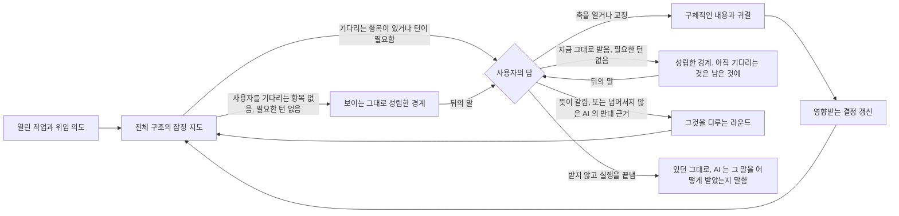

# Horismos — /bound (ὁρισμός)

작업이 기대는 결정을 봅니다 — 틀리면 무엇을 치르는지, 무엇이 정했는지, 무엇이 열려 있고 누가 정하는지.

> [English](./README.md)

위임하고 싶다는 의도는 목표가 확정되거나 어떤 결정이 필요한지 알기 전에도 생깁니다. `/bound`는 주어진 맥락에서 관련 구조 전체의 초안을 먼저 만듭니다. 각 결정이 왜 필요한지, 무엇에 의존하는지, 어떤 부분이 출처에 따라 이미 정해졌고 어떤 부분이 잠정적이거나 미정인지 보여줍니다.



사용자는 어느 축이든 열어 잠정 내용을 살펴보고, 틀을 고친 뒤 맡길 수 있습니다. 축마다 살펴보는 깊이가 달라도 됩니다. 하나를 열었다고 그 제안을 채택하거나 나머지 모든 축을 확인해야 하는 것은 아닙니다. 경계는 두 길로 섭니다. 사용자가 어떤 말로든 지금의 경계를 받으면 지금까지의 대화로 경계를 설정합니다. 또는 지도 위에 사용자를 기다리는 항목이 없으면 지도가 보지 않은 곳과 함께 보이는 그대로 경계가 섭니다. 어느 길이든 사용자의 턴이 아직 필요하지 않을 때만 섭니다. 예를 들어 뜻이 갈리는 답이나 사용자가 넘어서지 않은 AI 의 반대 근거가 있으면 먼저 그것을 다루는 라운드가 옵니다. 보여 달라는 요청은 보여 주기만 하고, 선 경계는 그대로 섭니다. 다른 답은 경계를 이어갑니다. 라운드는 AI 가 밝힌 판단으로 되돌릴 수 있는 일을 더 이어 갈 수 있고, 그때는 사용자의 말을 어떻게 읽었는지, 무엇을 어떤 근거로 판단했는지, 어디까지 갔는지를 설명으로 돌려줍니다. 경계를 받지 않고 실행을 끝내는 말은 실행을 있던 그대로 두고, AI 는 그 말을 어떻게 받았는지 말합니다. 선 경계도 사용자의 다음 말이 닿으면 다시 엽니다. 다른 일로 옮겨 가도 닫히는 것은 없습니다. AI 의 제안은 AI 의 것이라는 표시와 근거, AI 의 반대 근거가 있으면 그것까지 보인 채 사용자가 받았을 때만 경계에 들어갑니다.

예를 들어 프로젝트 지도에 대상 사용자는 이미 정해졌고, 데이터 처리 방식은 비교가 필요하며, 배포일은 미정이라고 표시할 수 있습니다. 사용자는 데이터 처리를 열어 외부 전송을 제외하고, 비교 작업을 맡기면서 최종 선택은 직접 하겠다고 정할 수 있습니다. 그러면 영향을 받는 후보를 갱신하고 배포일은 미정으로 남깁니다. 선 경계는 — 사용자가 받았든 기다리는 항목이 없었든 — 살펴본 깊이에서 선 것이며, 열린 프로젝트 질문을 모두 해결했다는 뜻이 아닙니다.

결과는 `BoundaryUndefined → DefinedBoundary`입니다. 결정마다 처분 — 누가 냈고 어떻게 섰는지 — 이 달린 현재 지도, 아직 열린 질문과 그 각각이 왜 걸리는지 · 누가 정하는지(이번 실행의 말인지 앞선 결정인지), 지도가 보지 않은 곳, AI 가 기록한 반대 근거와 경계를 성립시킨 기록의 참조를 함께 전달합니다. 후속 에이전트는 그 출처를 읽어야 합니다. 제안 작업을 맡겨도 선택권은 보유자에게 남고, 재량을 맡긴 경우에는 실제 허용 범위 안에서 선택할 수 있습니다. 다른 프로토콜이 요구하는 체크포인트는 계속 적용됩니다.

## 설치와 사용

```bash
claude plugin marketplace add https://github.com/jongwony/epistemic-protocols
claude plugin install horismos@epistemic-protocols
```

```text
/bound [경계를 정의할 작업이나 관심사]
```

## 계약과 검증

- [SKILL.md](skills/bound/SKILL.md)는 잠정 구조의 발견, 점진적 검토, 출처에 따른 결정, 그리고 사용자의 받음이나 사용자가 정할 것이 남지 않은 지도로 닫히는 수렴을 정의합니다. 이 정의는 elaborate 되는 Lean 4 블록입니다.
- [라운드 구성](skills/bound/references/round-composition.md)은 특정 상황에서 필요한 제시 규칙을 담습니다.
- [저장소 검증 지침](../AGENTS.md#verification)에 기여자용 작업 흐름이 있습니다. 이 플러그인의 Lean 계약 검사, 정적 검사, 패키징 검증은 저장소 루트에서 다음 명령을 순서대로 실행합니다.

```bash
node .claude/skills/verify/scripts/lean-contract.js check .
node .claude/skills/verify/scripts/static-checks.js .
node --test .claude/skills/verify/scripts/static-checks.test.mjs
node --test scripts/package.test.js
```

정적 검사는 구조적 속성을 확인합니다. 실제 대화가 낯선 결정 구조를 알아볼 수 있게 하고 사용자가 선택한 깊이를 지키는지는 실제 상호작용 기록을 읽어 검증해야 합니다.
